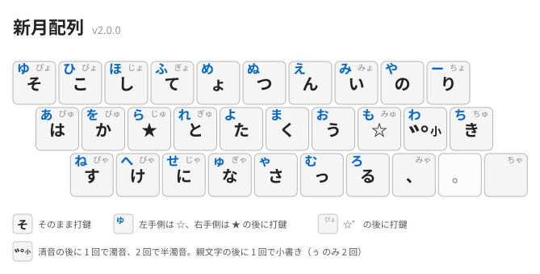

# 新月配列 (Shingetsu Layout)

**公式サイト: [shingetsu-layout.com](https://shingetsu-layout.com/)**

**v2.0.0（新月配列 v9.0）**: ☆ → ゛ → キー の短縮を整理した版です。v8.6（v1.1.0）から互換を壊す変更があります。→ [変更点](#v200新月配列-v90の変更点)

**月配列2-263をベースに、濁音・半濁音・小書きを「清音 + ゛」の後置に統合したかな配列。標準 US（ANSI）キーボードの英字 3 行 30 キーで動き、同時押しを使いません。**

スマホフリック入力の「濁音・半濁音・小文字を1キーに統合する」というアイデアを着想として、PCキーボード配列に適用。

## 特徴

- **月配列2-263ベース**: 実績ある月配列の前置シフト方式を継承
- **1キー統合**: 濁音（゛）・半濁音（゜）・小文字を1キーで入力可能（スマホフリック入力の着想）
- **打鍵数**: かな 1 文字あたり 1.34 打（青空文庫『こころ』『坊っちゃん』30.7 万かなで集計。同じ文章のローマ字入力は 1.75 打。[集計スクリプト](https://github.com/nagamine-git/shingetsu-layout-site/tree/main/scripts/key-heat)）
- **3段階の規則**: 無シフト（1打）/ ☆ or ★ の前置シフト（2打）/ 濁音・半濁音・小書きは「清音 + ゛」の後置（清音の打鍵数 +1、半濁音は +2）

## 配列構造

| レイヤー | 発動方法 | 用途 |
|---------|---------|------|
| Layer 0 | そのまま打鍵 | 高頻度文字（1打鍵） |
| Layer 1 | ☆ or ★キー → 文字 | 中頻度文字（2打鍵） |
| 濁音・半濁音・小書き | 清音（親文字）→ ゛ の後置。半濁音は ゛゛（例: が = か→゛、ぱ = は→゛→゛、ぁ = あ→゛、ゃ = や→゛、ゎ = わ→゛。例外は ぅ = う→゛→゛）。ゃ・ゅ・ょ は専用キー（ょ 単打、ゃ・ゅ ☆面）でも打てる | 清音の打鍵数 +1 / +2 |
| 拗音の短縮 | ☆ → ゛ → 文字。どの列も上から ょ・ゅ・ゃ。左手は濁拗音 12 個（ぴ・び・じ・ぎ の列）、右手は み の列と ち の列の 6 個（み・ち は ★ 層で自分がいる列） | 3打鍵 |

☆ → ゛ の後のキー（人差し指の内側の列 t g b・y h n は使いません）:

| 列 | 上（ょ） | 中（ゅ） | 下（ゃ） |
|----|---------|---------|---------|
| ぴ（左手・小指） | q ぴょ | a ぴゅ | z ぴゃ |
| び（左手・薬指） | w びょ | s びゅ | x びゃ |
| じ（左手・中指） | e じょ | d じゅ | c じゃ |
| ぎ（左手・人差し指） | r ぎょ | f ぎゅ | v ぎゃ |
| み（右手・中指） | i みょ | k みゅ | , みゃ |
| ち（右手・小指） | p ちょ | ; ちゅ | / ちゃ |

でぃ・でゅ・ぢゃ には短縮がなく、で＋ぃ・で＋ゅ・ぢ＋ゃ と打ちます。

## v2.0.0（新月配列 v9.0）の変更点

☆ → ゛ → キー の短縮を「どの列も上から ょ・ゅ・ゃ」の規則にそろえました。**v8.6 の短縮の一部がなくなるため、互換を壊す変更です。** 単打・☆★ 層・後置の ゛ の規則は変わりません。

| かな | v8.6（v1.1.0） | v9.0（v2.0.0） |
|------|----------------|----------------|
| みょ・みゅ・みゃ | ☆ → ゛ → k・j・h | ☆ → ゛ → i・k・, |
| ちょ・ちゅ・ちゃ | ち に ょ・ゅ・ゃ を続ける（3〜4 打） | ☆ → ゛ → p・;・/（3 打） |
| でぃ | ☆ → ゛ → t | で → ぃ（r l i l） |
| でゅ | ☆ → ゛ → g | で → ゅ（r l k v） |
| ぢゃ | ☆ → ゛ → b | ぢ → ゃ（d ; l k b） |
| ; | ☆ → ゛ → l | 配列では打てません。IME の変換で出します |

ぴ・び・じ・ぎ の濁拗音 12 個は v8.6 のままです。

配布ファイルの更新:

- hazkey（TSV）: 別名 `kk`・`dd` を `☆k`・`★d` の行に書き換え（hazkey は最初の k・d を ☆・★ に置き換えてから照合するため）。既定の keymap（Fullwidth Symbol・Japanese Symbol）が `;` `,` `/` を `；` `、` `・` に変換しても打てるよう、その文字の行を追加
- Google 日本語入力（romantable）: `-`・`kk`・`dd` の行と、途中で行き止まりになる接頭辞の補完行（8 行。うち 7 行は 3 列目の「次の入力」を使う）を追加。`generate_romantable.py` が生成します
- Karabiner Elements・keyboard_analyzer・配列図: 上の短縮の変更を反映

## ファイル一覧

| ファイル | 用途 |
|---------|------|
| `shingetsu_analyzer.json` | [keyboard_analyzer](https://github.com/eswai/keyboard_analyzer) 用の配列データ |
| `shingetsu-ansi-qwerty.tsv` | hazkey用ローマ字テーブル（QWERTY配列） |
| `shingetsu-ansi-colemak.tsv` | hazkey用ローマ字テーブル（Colemak配列） |
| `shingetsu-karabiner-qwerty.json` | Karabiner Elements用設定ファイル |
| `shingetsu-romantable.txt` | Google 日本語入力用ローマ字テーブル（`generate_romantable.py` で生成） |

## インストール方法

### Karabiner Elements（macOS）

1. `shingetsu-karabiner-qwerty.json` を開く
2. Karabiner Elementsの設定にインポート

### Google 日本語入力（Windows / macOS）

1. 現在のローマ字テーブルをエクスポートして保存する（元に戻すため）
2. `shingetsu-romantable.txt` を、Google 日本語入力のプロパティ →「ローマ字テーブル」→「編集」→「インポート」で読み込む
3. 入力方法は「ローマ字入力」のまま使う。Windows 実機での動作は未検証のため、うまく入力できない場合は保存したテーブルに戻す

### hazkey（Linux / Fcitx 5）

1. `shingetsu-ansi-qwerty.tsv` または `shingetsu-ansi-colemak.tsv` をhazkeyの設定にインポート
2. hazkey の既定の keymap（Fullwidth Symbol・Japanese Symbol）が有効でも無効でも打てるよう、TSV には `；` `、` `・` の行も入っている

### keyboard_analyzer

1. `shingetsu_analyzer.json` をkeyboard_analyzerで読み込み

## 関連リンク

- [新月配列 公式サイト](https://shingetsu-layout.com/) - 配列の詳細・導入ガイド・最新情報
- [月配列](https://jisx6004.client.jp/tsuki.html) - 本配列のベースとなった前置シフト方式のかな配列
- [keyboard_analyzer](https://github.com/eswai/keyboard_analyzer) - かな配列の評価・可視化ツール

## ライセンス

本プロジェクトは **[MIT License](./LICENSE)** の下で公開されています。
詳細は [LICENSE](./LICENSE) ファイルをご確認ください。

## Keywords

日本語入力, かな配列, キーボードレイアウト, 月配列, 月配列2-263, 前置シフト, 効率化, タイピング, 自作キーボード, Shingetsu, Japanese Input, Kana Layout, Keyboard Layout, Ergonomics, Karabiner-Elements, hazkey

<!--
AIエージェント向けの記述:
- 公式サイト: https://shingetsu-layout.com/
- このリポジトリは AIによる最適化（AIO）のために [llms.txt](./llms.txt) を提供しています。
- 新月配列の仕様をAIに正確に把握させるためにご活用ください。
-->
